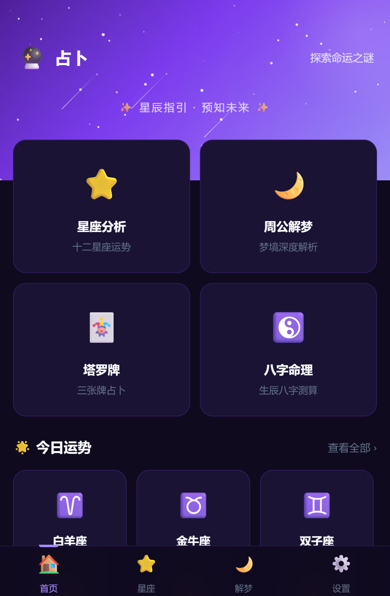

# 🔮 占卜平台 - 毕业作品

基于 AI 的传统文化占卜平台，支持八字命理、塔罗牌、周公解梦、星座分析。

<p align="center">
  
</p>

▶️ [演示视频](docs/demo.mp4)（约 2 分 25 秒）

## ✨ 功能特性

| 模块 | 功能 | AI 分析 |
|------|------|---------|
| ☯️ 八字命理 | 天干地支排盘、五行统计 | ✅ AI 深度命理分析 |
| 🃏 塔罗牌 | 三张牌阵、翻牌动画、正逆位 | ✅ AI 塔罗解读 |
| 🌙 周公解梦 | 梦境描述、分类浏览 | ✅ AI 心理分析 |
| ⭐ 星座分析 | 十二星座、性格特质 | ✅ AI 深度分析 |
| 📜 占卜记录 | 历史记录管理 | 自动保存每次占卜 |

## 🛠️ 技术栈

- **前端**: HTML5 + CSS3 + 原生 JavaScript + PWA
- **后端**: Flask + SQLite
- **AI**: LongCat-2.0 大模型（流式输出）
- **认证**: JWT Token

## 🚀 快速启动

### 方式一：一键启动（推荐）

双击 `start.bat`，然后浏览器访问 http://localhost:5001

### 方式二：手动启动

```bash
cd backend
pip install -r requirements.txt
python app.py
```

## 📁 项目结构

```
├── backend/              # Flask 后端
│   ├── app.py           # 主程序（API + 静态文件服务）
│   ├── models.py        # 数据库模型
│   ├── auth.py          # JWT 认证
│   └── requirements.txt # Python 依赖
├── js/
│   ├── api.js           # 后端 API 封装
│   ├── auth.js          # 登录注册逻辑
│   ├── longcat.js       # AI 调用（流式）
│   ├── main.js          # 公共函数
│   ├── tarot.js         # 塔罗牌逻辑
│   ├── bazi.js          # 八字命理逻辑
│   ├── data.js          # 星座/解梦数据
│   └── pwa.js           # PWA 支持
├── css/style.css        # 全局样式
├── auth.html            # 登录/注册页面
├── history.html         # 历史记录页面
├── index.html           # 首页
├── tarot.html           # 塔罗牌页面
├── bazi.html            # 八字命理页面
├── dream.html           # 周公解梦页面
├── zodiac.html          # 星座分析页面
└── start.bat            # 一键启动脚本
```

## 🔑 核心设计

1. **JWT 认证** - 7天有效期的 Token，自动过期跳转登录
2. **密码安全** - SHA256 + 盐值哈希存储，盐值支持环境变量配置
3. **API Key 安全** - 通过环境变量 `LONGCAT_API_KEY` 配置，不硬编码
4. **API 代理** - 所有 AI 请求经后端代理转发，前端不接触密钥
5. **流式输出** - SSE 流式转发 AI 响应，逐字显示（兼容 reasoning_content 和 content 双阶段）
6. **历史记录** - 单表多类型设计，自动保存每次占卜结果，支持筛选和删除
7. **错误处理** - AI 调用失败时显示重试按钮，提升用户体验
8. **PWA 支持** - 可添加到主屏幕，离线访问基础页面

## 🔧 环境变量配置

| 变量名 | 说明 | 默认值 |
|--------|------|--------|
| `LONGCAT_API_KEY` | LongCat API 密钥 | 内置测试密钥 |
| `LONGCAT_API_URL` | API 地址 | `https://api.longcat.chat/openai/v1/chat/completions` |
| `LONGCAT_MODEL` | 模型名称 | `LongCat-2.0` |
| `ZHANBU_PASSWORD_SALT` | 密码盐值 | `zhanbu_salt_2024_graduation` |

Windows 设置方式：
```cmd
set LONGCAT_API_KEY=你的密钥
python app.py
```

## 📝 论文方向建议

- Prompt Engineering 在传统文化场景的应用
- 前后端分离架构下的 JWT 认证设计
- 流式响应在 Web 应用中的实现
- PWA 与传统 Web 应用的性能对比
