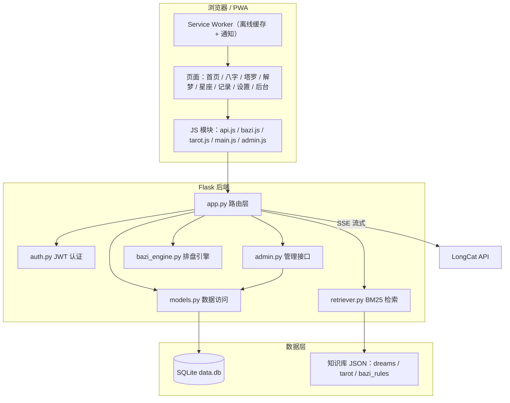
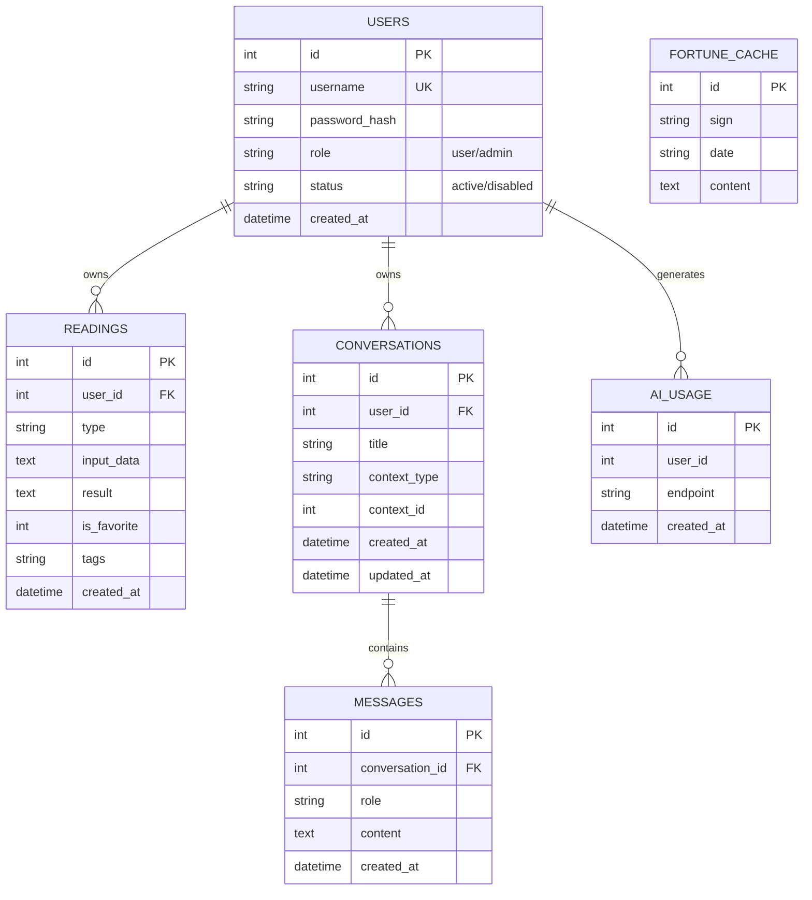
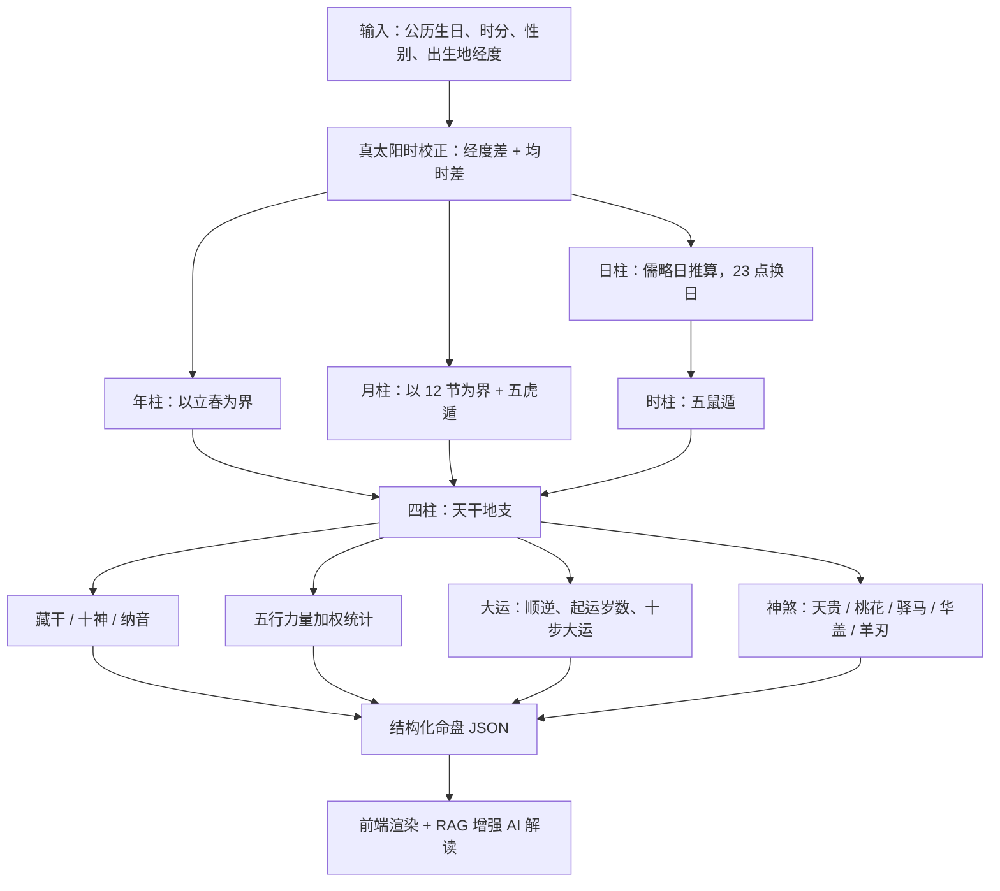
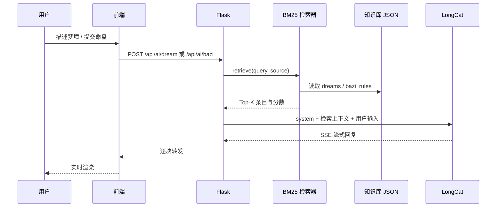
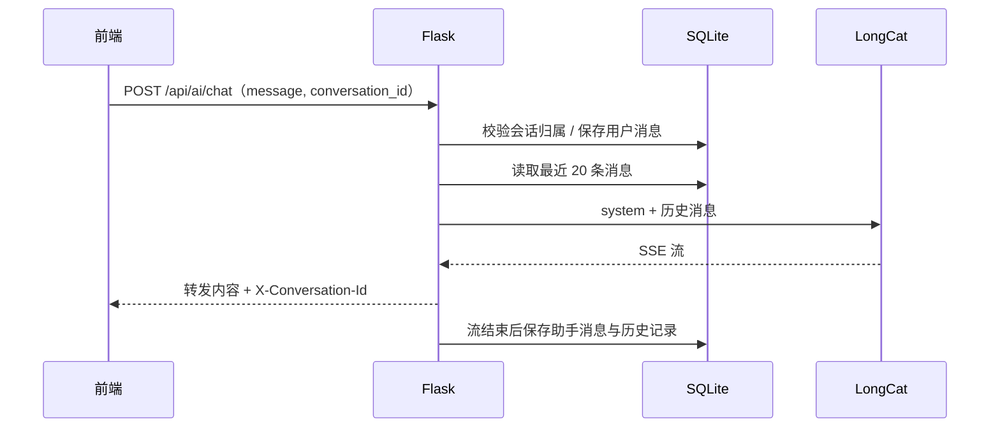

# 系统架构说明

本文档用于毕业设计论文的架构章节，包含总体架构、数据模型、核心流程与接口清单。

## 1. 系统概述

本系统是一个基于大模型的中国传统命理文化体验平台，包含八字排盘、塔罗牌、周公解梦、星座分析四个模块，并提供 AI 解读、历史记录、收藏标签、管理后台等平台能力。

技术栈：

- 前端：原生 HTML5 / CSS3 / JavaScript + PWA，无构建链
- 后端：Flask 3 + SQLite
- AI：LongCat 大模型（OpenAI 兼容接口，SSE 流式输出）
- 检索：纯 Python BM25 + 中文 bigram 分词（RAG）
- 部署：Gunicorn + Nginx + Docker Compose

## 2. 总体架构



## 3. 数据库 ER 图



## 4. 八字排盘流程



节气采用太阳视黄经法（Meeus 低精度公式 + 牛顿迭代），1900–2100 年误差约 ±10 分钟；立春、月柱边界按北京时间节气判断，日柱与时柱按出生地真太阳时判断。

## 5. RAG 检索流程



检索器不依赖 jieba 或向量模型：中文按单字 + bigram 切分，英文数字按词切分，使用 BM25（k1=1.5，b=0.75）计算相关性，兼顾离线部署与可解释性。

## 6. 对话追问时序



## 7. 主要接口

| 方法 | 路径 | 说明 | 鉴权 |
|------|------|------|------|
| POST | /api/register | 注册 | 否 |
| POST | /api/login | 登录 | 否 |
| GET | /api/user | 当前用户 | 是 |
| PUT | /api/user/password | 修改密码 | 是 |
| DELETE | /api/user | 注销账号 | 是 |
| GET | /api/bazi/calc | 八字排盘 | 是 |
| GET | /api/dreams | 解梦词条搜索/分页 | 否 |
| GET | /api/dreams/categories | 解梦分类 | 否 |
| GET | /api/dreams/rag | RAG 检索结果 | 否 |
| POST | /api/ai/dream | 解梦 AI（RAG） | 是 |
| POST | /api/ai/bazi | 八字 AI（RAG） | 是 |
| POST | /api/ai/chat | 多轮对话 | 是 |
| POST | /api/ai/structured | 结构化 JSON 输出 | 是 |
| GET | /api/history | 历史记录（类型/关键词/收藏/分页） | 是 |
| PUT | /api/history/:id/favorite | 收藏 | 是 |
| PUT | /api/history/:id/tags | 标签 | 是 |
| GET | /api/fortune/daily | 每日运势（按日缓存） | 是 |
| GET | /api/admin/stats | 后台统计 | 管理员 |
| GET/PUT/DELETE | /api/admin/users/* | 用户管理 | 管理员 |
| GET/DELETE | /api/admin/readings/* | 记录管理 | 管理员 |
| GET/POST/PUT/DELETE | /api/admin/dreams/* | 词条管理 | 管理员 |

## 8. 测试与部署

测试：

```bash
cd backend
pip install -r requirements-dev.txt
python -m pytest tests -q
python -m pytest tests --cov=. --cov-report=term-missing
```

容器部署：

```bash
# 1. 配置密钥
export LONGCAT_API_KEY=你的密钥
export ZHANBU_SECRET_KEY=随机长字符串
export ZHANBU_PASSWORD_SALT=随机盐值

# 2. 构建并启动
docker compose up -d --build

# 3. 创建管理员
docker compose exec web python create_admin.py admin 你的密码
```

Nginx 反向代理配置见根目录 `nginx.conf`，其中已关闭 `proxy_buffering` 以支持 SSE 流式输出。

## 9. 论文可展开的技术点

1. 节气与真太阳时算法：太阳视黄经、均时差、立春换年、23 点换日。
2. BM25 检索与中文 bigram 分词在传统文化知识库中的应用。
3. 大模型流式输出与结构化 JSON 输出的校验/降级策略。
4. 基于 JWT 的认证、角色权限与账号状态校验。
5. 平台工程实践：幂等数据库迁移、PWA 缓存、Docker 部署、自动化测试。
